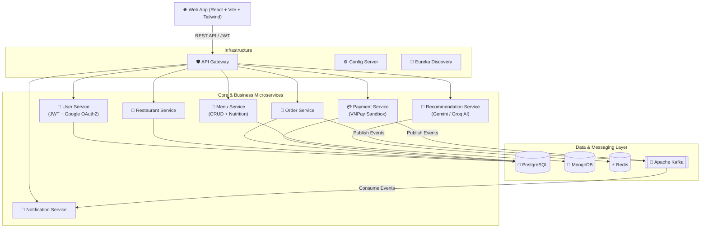

# 🍔 NomNom – AI-Powered Food Ordering & Delivery Platform

[](https://openjdk.org/)
[](https://spring.io/projects/spring-boot)
[](https://spring.io/projects/spring-cloud)
[](https://react.dev/)
[](https://www.docker.com/)

**NomNom** is a cloud-native, microservices-based food ordering and restaurant management platform. Built with **Spring Boot**, **Spring Cloud**, **Apache Kafka**, and **React (Vite + TypeScript)**, the system integrates **Generative AI (Google Gemini & Groq)** for personalized meal/nutrition recommendations and **VNPay** for seamless online payments.

---

## 🏗️ System Architecture



---

## 🧩 Microservices Overview

The backend is structured as a Maven multi-module project (`com.nomnom`) consisting of **10 modules**:

| Module | Category | Description |
| :--- | :--- | :--- |
| **`config-server`** | Infrastructure | Centralized configuration management across all microservices. |
| **`eureka-server`** | Infrastructure | Service discovery and registration server (`:8761`). |
| **`api-gateway`** | Infrastructure | Single entry point routing requests with centralized JWT `AuthenticationFilter`. |
| **`user-service`** | Core | User authentication (Local JWT & Google OAuth 2.0), profile & avatar management, RBAC. |
| **`restaurant-service`** | Core | Restaurant onboarding, store settings, operating hours, and catalog browsing. |
| **`menu-service`** | Business | Menu item CRUD, categorization, pricing, and nutritional facts tracking. |
| **`order-service`** | Business | Cart checkout, order lifecycle management, inter-service communication & Kafka event publishing. |
| **`payment-service`** | Business | Online payment processing integrated with **VNPay Sandbox** & webhook verification. |
| **`notification-service`** | Business | Event-driven service consuming Kafka order/payment events to push real-time user alerts. |
| **`recommendation-service`**| AI | Personalized food & nutrition recommendations powered by **Google Gemini** and **Groq LLM**. |

---

## ✨ Key Features

* **👨‍🍳 Multi-Role Ecosystem:**
  * **Customer:** Browse restaurants & menus with nutritional badges, AI meal assistant, real-time cart & checkout, VNPay online payment, live order tracking, and loyalty rewards.
  * **Restaurant Owner:** Dedicated dashboard for live order processing, menu & nutritional management, and restaurant settings.
  * **System Admin:** Platform-wide overview, user management, and restaurant approval workflows.
* **🤖 AI Dietary & Meal Assistant:** Dual-provider LLM integration (**Gemini API** & **Groq Cloud**) suggesting dishes based on user preferences, calorie targets, and order history.
* **⚡ Event-Driven Architecture:** Asynchronous communication between `order-service`, `payment-service`, and `notification-service` via **Apache Kafka**.
* **🔐 Secure Authentication:** Stateless JWT authentication at the API Gateway level combined with **Google Identity Services (OAuth 2.0)**.

---

## 🛠️ Tech Stack

* **Backend:** Java 21, Spring Boot 3.x, Spring Cloud (Gateway, Netflix Eureka, Config, OpenFeign), Spring Security, JWT (HS256), Maven.
* **Databases & Messaging:** PostgreSQL, MongoDB, Redis, Apache Kafka (with Zookeeper & Kafka UI).
* **AI & Third-Party APIs:** Google Gemini API, Groq API, Google OAuth 2.0, VNPay Payment Gateway.
* **Frontend (`fe/`):** React 18, TypeScript, Vite, Tailwind CSS, Zustand (State Management), Shadcn-UI primitives, Nginx.
* **DevOps & Tooling:** Docker, Docker Compose (Infra, Full-stack & Centralized Logging), PowerShell automation scripts, Postman.

---

## 🚀 Getting Started

### 1. Prerequisites
* **Docker Desktop** & **Docker Compose**
* **JDK 21 LTS** & **Apache Maven 3.9+** (if running services locally outside Docker)
* **Node.js 20+** & **npm** (for local frontend development)

### 2. Environment Configuration
Copy the `.env.example` template to `.env` (and `.env.local` if required) in the root directory and fill in your credentials:

```bash
cp .env.example .env
```

Key environment variables to configure in `.env`:
```env
# Google OAuth 2.0 (Authorized origin: http://localhost:5173)
GOOGLE_CLIENT_ID=your_google_client_id.apps.googleusercontent.com
VITE_GOOGLE_CLIENT_ID=your_google_client_id.apps.googleusercontent.com

# AI Providers (for recommendation-service)
GEMINI_API_KEY=your_gemini_api_key
GROQ_API_KEY=your_groq_api_key

# VNPay Sandbox Credentials
VNPAY_TMN_CODE=your_vnpay_tmn_code
VNPAY_HASH_SECRET=your_vnpay_hash_secret
```

### 3. Run the Platform

**Option A: Full-Stack via Docker Compose (Recommended)**
Spin up all databases, message brokers, backend microservices, and the frontend web app with a single command:
```powershell
docker compose up -d --build
```

**Option B: Hybrid Local Development (Infra in Docker + Local Services)**
1. Start the infrastructure containers (PostgreSQL, MongoDB, Redis, Kafka):
   ```powershell
   docker compose -f docker-compose.infra.yml up -d
   ```
2. Run the automated PowerShell startup script to launch backend services and frontend:
   ```powershell
   .\scripts\start-all.ps1
   ```

### 4. Access Endpoints
| Service | URL |
| :--- | :--- |
| **Frontend Web App** | `http://localhost:5173` |
| **API Gateway** | `http://localhost:8080` |
| **Eureka Discovery Dashboard** | `http://localhost:8761` |
| **Kafka UI** | `http://localhost:8090` (if enabled in compose) |

---

## 📬 API Documentation & Testing

A complete Postman collection and environment configuration are available in the [`postman/`](./postman) directory. Import the collection into Postman to test individual endpoints across Authentication, Restaurants, Menus, Orders, VNPay Checkout, and AI Recommendations.

---

## 📂 Project Structure

```text
WebVersion/
├── .github/                  # GitHub Issue & PR templates
├── docs/                     # Architecture specs & implementation plans
├── fe/                       # React + TypeScript + Vite Frontend application
├── infrastructure/
│   ├── config-server/        # Centralized Spring Cloud Config
│   ├── eureka-server/        # Service Discovery
│   └── api-gateway/          # API Gateway & JWT Filter
├── postman/                  # Postman API Collections
├── scripts/                  # Database init SQL & PowerShell startup scripts
├── services/
│   ├── user-service/         # Auth, Users, Google OAuth, Avatar
│   ├── restaurant-service/   # Restaurant management
│   ├── menu-service/         # Menus & Nutrition facts
│   ├── order-service/        # Orders & Kafka Producers
│   ├── payment-service/      # VNPay integration
│   ├── notification-service/ # Kafka Consumers & Alerts
│   └── recommendation-service/# Groq & Gemini AI Recommendations
├── .env.example              # Environment variable template
├── docker-compose.infra.yml  # Infrastructure-only Docker Compose
├── docker-compose.logs.yml   # Centralized logging stack
├── docker-compose.yml        # Full-stack Docker Compose
└── pom.xml                   # Maven parent POM
```
